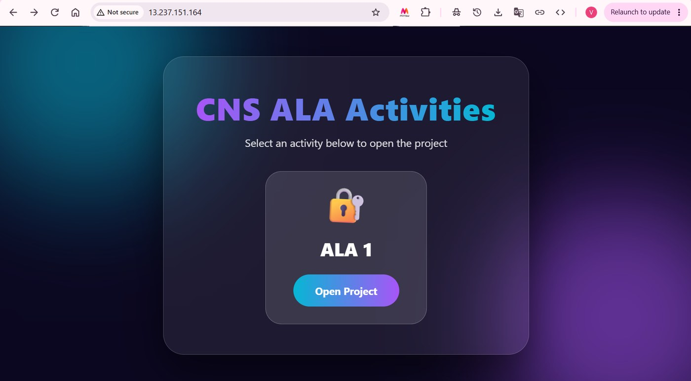
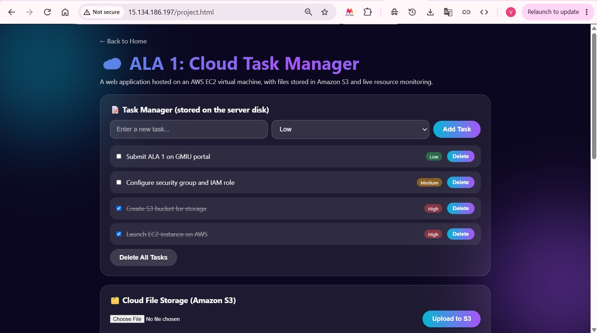
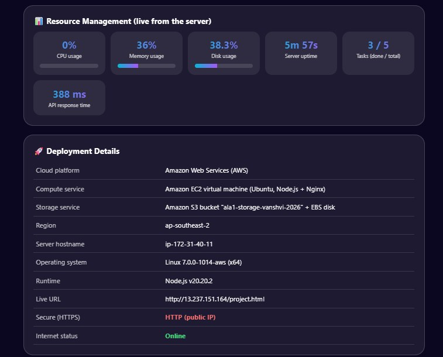

# ALA 1: Cloud Task Manager on AWS

A basic web application deployed on Amazon Web Services, with a compute service (EC2), a storage service (S3) and resource monitoring.

**Live application:** http://13.237.151.164  
**Project page:** http://13.237.151.164/project.html  
**Full report (PDF):** [public/report/ALA1_Cloud_Report.pdf](public/report/ALA1_Cloud_Report.pdf)

## What the app does

- **Task manager:** add, complete and delete tasks; tasks are saved on the server disk.
- **Cloud file storage:** upload files to an Amazon S3 bucket and list them in the app.
- **Resource management:** live CPU, memory and disk usage, uptime and API response time from the server.
- **Deployment details:** platform, services, region and live URL shown inside the app.

## Cloud setup

| Item | Detail |
| --- | --- |
| Cloud platform | Amazon Web Services (AWS), region ap-southeast-2 (Sydney) |
| Compute | EC2 t3.micro, Ubuntu Server 24.04 LTS (ala1-server) |
| Web server | Nginx reverse proxy on port 80, Node.js (Express) app on port 3000, PM2 process manager |
| Storage | Amazon S3 bucket (uploaded files) and 8 GiB EBS volume (tasks) |
| Access control | IAM role with S3 access, security group allowing ports 22 and 80 |
| Public address | Elastic IP 13.237.151.164 |
| Monitoring and cost | CloudWatch CPU graph, AWS Budget alert, stop and start test |

## Screenshots







All 20 screenshots are also shown on the live project page. More detail and the step-by-step setup are in the [report](public/report/ALA1_Cloud_Report.pdf).

## Project structure

```
server.js          Express server: task API, S3 upload, stats
public/            Home page, project page and report
DEPLOY_GUIDE.md    Step-by-step AWS deployment guide
public/report/     Report PDF (also served by the app)
public/screenshots/ All screenshots (shown in the app and used in this README)
```

## Run locally

```
npm install
S3_BUCKET=<your-bucket> AWS_REGION=ap-southeast-2 node server.js
```

Without `S3_BUCKET` the app still runs; only the file upload feature is disabled.
